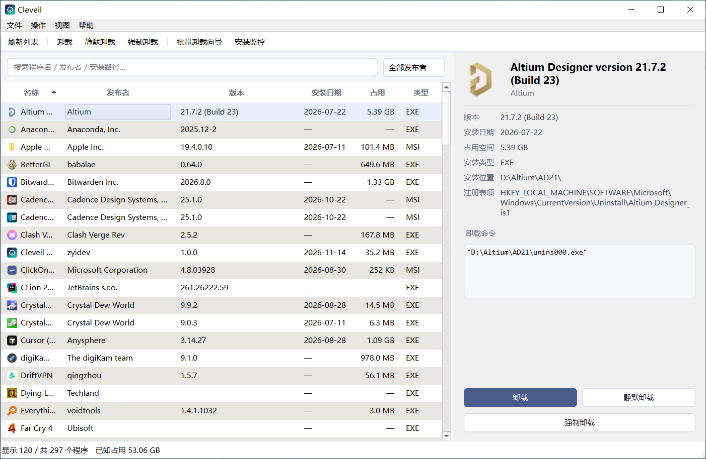
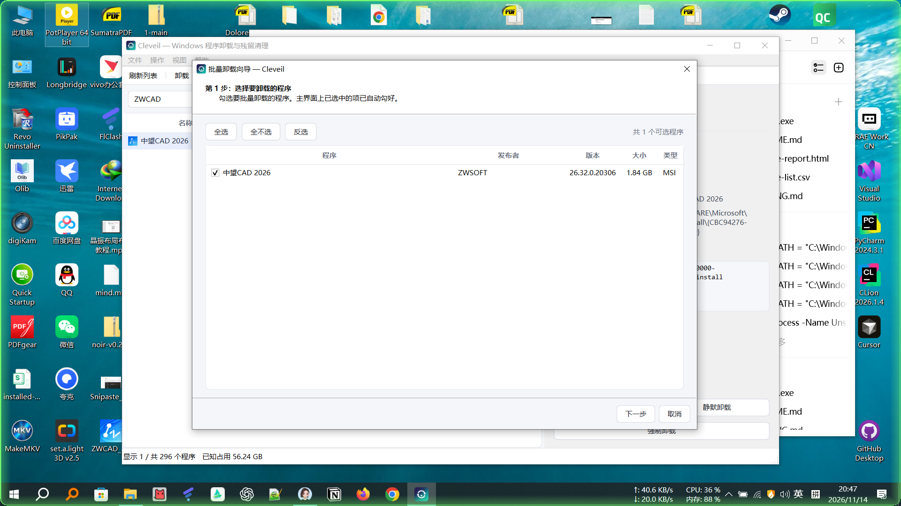

# Cleveil

[中文](README.md) ｜ **English**


A Windows uninstaller and leftover cleaner. Installed items come from Windows itself: the registry, MSI, Store packages, OEM driver packages, services, and installer uninstall files. Uninstalling is still handed to each program's own uninstaller (MSI via `msiexec`).

Current version **1.2.1** (fixes a startup crash in 1.2.0). Download `Cleveil-1.2.1-win64-setup.exe` from [Releases](https://github.com/zyidev/Cleveil/releases). It installs into the current user's folder and does not require administrator rights.


## Table of contents

- [1. Features](#1-features)
- [2. Screenshots](#2-screenshots)
- [3. Build](#3-build)
- [4. Repository layout](#4-repository-layout)
- [5. License and disclaimer](#5-license-and-disclaimer)

---

## 1. Features

- **Scan**: merges the registry, MSI, Store packages, OEM driver packages, services, and installer uninstall files. The same program is one row, with its sources marked. Shortcuts, EXE version info, and directory snapshots identify portable apps; they stay hidden by default and cannot be uninstalled directly.
- **Uninstall**: normal, silent, and force uninstall, plus a batch wizard that can be stopped mid-run.
- **Leftover cleanup**: scans the registry, folders, shortcuts, services, and scheduled tasks. Files go to the Recycle Bin; registry keys are exported first. Shared system components such as runtimes cannot be uninstalled by default.
- **Also**: live install monitor (including Store packages), CSV / HTML export. Signing tools are in [docs/SIGNING.md](docs/SIGNING.md).

---

## 2. Screenshots

| Main window | Batch wizard (pick programs) |
| --- | --- |
|  |  |

---

## 3. Build

Requirements:

| Component | Version (as tested) |
| --- | --- |
| Visual Studio | 2022 / 2026 with the "Desktop development with C++" workload (MSVC 19.5x) |
| Qt | 6.10 or newer, MSVC kit (tested 6.11.1 `msvc2022_64`) |
| CMake | 3.21+ (tested 3.30.5) |
| Ninja | 1.10+ (tested 1.12.1) |

One command (the script injects the MSVC environment itself, no developer prompt needed):

```powershell
cd Cleveil-1.2.0            # the project root after clone/extract
.\build.ps1                 # Release build + windeployqt deployment
.\build.ps1 -Config Debug   # Debug build
.\build.ps1 -Clean          # wipe build/ and start over
```


## 4. Repository layout

```
src/
├─ main.cpp                     entry: high-DPI policy, Fusion style, QSS theme, app icon, OleInitialize
├─ core/
│  ├─ appinfo.h                 InstalledApp struct + PackageType enum
│  ├─ winutil.h/.cpp            Win32 helpers: env expansion, icon→QPixmap, elevated exec, recycle-bin
│  │                            delete, folder size, registry read/write/backup, process & service ops
│  ├─ iconprovider.h/.cpp       three-level icon sources + cache + fallback placeholder drawing
│  ├─ registryscanner.h/.cpp    four-way Uninstall scan, field parsing, dedupe
│  ├─ inventory/                multi-source scan and merge (MSI, AppX, drivers, services, installer files, heuristics)
│  ├─ uninstaller.h/.cpp        uninstall plan (MSI/EXE/silent), command splitting, QProcess & elevated runner
│  ├─ leftovers.h/.cpp          leftover scan (registry/folders/shortcuts/services/tasks) + delete & backup
│  ├─ remover.h/.cpp            force uninstall: kill processes, back up and delete the key, backup folder
│  ├─ exporter.h/.cpp           CSV / HTML export
│  ├─ installmonitor.h/.cpp     monitor: change-notification thread + installer detection + driver ABI
│  └─ signature.h/.cpp          Authenticode verification (WinVerifyTrust + CryptQueryObject)
└─ ui/
   ├─ appmodel.h/.cpp           table model (lazy icons, numeric sort) + filter proxy model
   ├─ mainwindow.h/.cpp         menus, toolbar, list, details, uninstall entries, export, monitor/wizard
   ├─ uninstalldialog.h/.cpp    uninstall queue dialog (sequential run + log + registry verification)
   ├─ batchwizard.h/.cpp        batch wizard (QWizard, three pages + sequential run + auto cleanup)
   ├─ monitordialog.h/.cpp      install monitor window (event stream + one-click uninstall + driver note)
   ├─ leftoverdialog.h/.cpp     leftover dialog (QtConcurrent background scan + progress + batch delete)
   └─ settingsdialog.h/.cpp     settings (multi-source and heuristic switches)
resources/
├─ icon-1024.png                icon artwork
├─ icon-256.png / app.ico       runtime PNG / multi-size icon
├─ app.rc                       ICON + VERSIONINFO (product name Cleveil)
└─ resources.qrc                Qt resources
scripts/
├─ make_icon.py                 icon tooling (rounded corners + PNG + ICO)
└─ sign.ps1                     Authenticode sign/verify script
docs/
└─ SIGNING.md                   signing options, certificate choice, driver-signing differences
```

---

## 5. License and disclaimer

Released under the **MIT License** — see [LICENSE](LICENSE).

> **Disclaimer**: uninstalling and cleaning leftovers are irreversible operations; the author is not liable for
> data loss, system damage or business interruption caused by using this tool.

If documentation and implementation disagree, the source code wins — issues are welcome.
