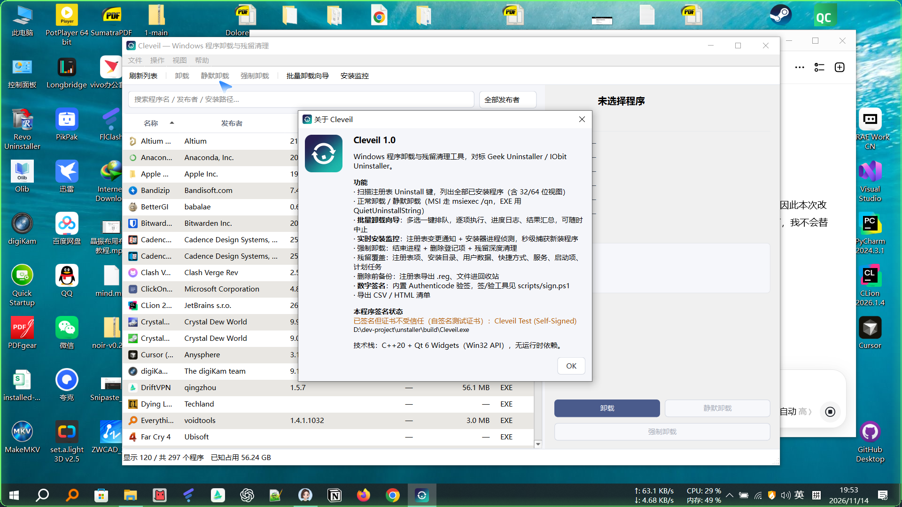

# Cleveil

[中文](README.md) ｜ **English**


A Windows uninstaller and leftover cleaner: scan installed programs → browse/search/sort → inspect details →
normal / silent uninstall → batch uninstall wizard → force uninstall with deep leftover cleanup → live install
monitor → export lists.

It reads no third-party database — every fact comes from Windows' own registry and file system — and it never
invents deletion logic: the program's own uninstaller does the job (MSI via `msiexec`, EXE via `UninstallString`).


## Table of contents

- [1. Features](#1-features)
- [2. Screenshots](#2-screenshots)
- [3. Build](#3-build)
- [4. Repository layout](#4-repository-layout)
- [5. License and disclaimer](#5-license-and-disclaimer)

---

## 1. Features

| Module | Capability |
| --- | --- |
| **Program scan** | Reads all four `Uninstall` branches (`HKLM`/`HKCU` × 32/64-bit view); fields include DisplayName / DisplayVersion / Publisher / InstallDate / EstimatedSize / InstallLocation / DisplayIcon / UninstallString / QuietUninstallString / SystemComponent / ReleaseType / ParentKeyName / WindowsInstaller. Deduplicated by name+version+publisher, machine-wide preferred over per-user, 64-bit view over 32-bit. |
| **List and filtering** | Six columns (name / publisher / version / install date / size / type), real icons (three-level fallback: `DisplayIcon` → uninstaller exe → install directory), numeric sorting for date and size, live search over name / publisher / path, publisher filter (all / Microsoft only / third-party only), optional system components and updates, multi-select. |
| **Details pane** | Icon, name, publisher, version, install date, size, package type (MSI / EXE), install path, full registry key path and the complete uninstall command (selectable). Long paths wrap with zero-width spaces so nothing is clipped. |
| **Three uninstall modes** | ① **Normal**: run the registered command, queue multiple entries. ② **Silent**: prefer `QuietUninstallString`; MSI gets `/qn /norestart`; programs without any silent switch are reported as unsupported instead of being forced. ③ **Force**: kill related processes, back up and delete the registration key, then go through leftover cleanup. |
| **Batch uninstall wizard** | Three pages: ① pick programs (select all / none / invert, pre-checked from the main window selection) ② choose strategy (prefer silent / confirm each item / auto-clean leftovers afterwards) ③ execute (progress bar, timestamped per-item log, success/failure/skip summary, stop request honoured after the current item). |
| **Live install monitor** | `RegNotifyChangeKeyValue` on the same four keys (kernel wakes the thread on write, no polling) plus `msiexec` / `setup.exe` style installer-process detection every 2 seconds. New programs appear within seconds and are highlighted; uninstall events are likewise captured. Switches to a kernel-driver channel when the device `\\.\CleveilMon` exists. |
| **Digital signature** | Built-in Authenticode verification (`WinVerifyTrust` for integrity and chain, `CryptQueryObject` for signer/issuer), plus `scripts/sign.ps1` supporting self-signed test certificates, PFX files, certificate thumbprints and RFC3161 timestamps — see [docs/SIGNING.md](docs/SIGNING.md). |
| **Leftover cleanup** | Multi-threaded scan of registry (SOFTWARE subtrees, App Paths, Run entries), install directory, look-alike folders under `LOCALAPPDATA` / `APPDATA` / `PROGRAMDATA` / `Program Files`, Start-menu and desktop shortcuts, services and scheduled tasks. Strong/weak keyword matching — weak hits are unchecked by default; registry keys are exported to `.reg` and folders go to the Recycle Bin; "space to free" is de-duplicated by outermost path. |
| **Uninstall queue** | Sequential execution, per-item timestamped log, progress bar; success is verified by whether the registration key disappeared, not by the exit code. |
| **Export** | CSV (UTF-8 with BOM, opens cleanly in Excel) and an HTML report with summary statistics. |
| **Settings** | Show system components / show updates / scan on startup / auto-elevate silent uninstall / back up registry before delete — persisted with `QSettings`; window geometry is remembered too. |
| **Branding** | Application name **Cleveil**, rounded-square gradient icon (deep indigo → teal, white circular arrows, a small block being removed), multi-size `app.ico` (16/24/32/40/48/64/128/256) embedded in the exe, plus a Qt resource used for the window icon. |

## 2. Screenshots

| Main window | Batch wizard (pick) | Install monitor |
| --- | --- | --- |
|  |  |  |

| Batch wizard (options) | About |
| --- | --- |
|  |  |

## 3. Build

Requirements (versions used for this project):

| Component | Version |
| --- | --- |
| Visual Studio | 2022 / 2026 with the "Desktop development with C++" workload (MSVC 19.5x) |
| Qt | 6.5 or newer, MSVC kit (tested with 6.11.1 `msvc2022_64`) |
| CMake | 3.21+ (tested 3.30.5) |
| Ninja | 1.10+ (tested 1.12.1) |

One command (the script injects the MSVC environment itself, no developer prompt needed):

```powershell
cd Cleveil-1.0.0            # the project root after clone/extract
.\build.ps1                 # Release build + windeployqt deployment
.\build.ps1 -Config Debug   # Debug build
.\build.ps1 -Clean          # wipe build/ and start over
```

Manual build:

```bat
call "C:\Program Files\Microsoft Visual Studio\18\Professional\Common7\Tools\VsDevCmd.bat" -arch=x64
"C:\Qt\Tools\CMake_64\bin\cmake.exe" -S . -B build -G Ninja -DCMAKE_BUILD_TYPE=Release -DCMAKE_PREFIX_PATH=C:/Qt/6.11.1/msvc2022_64
"C:\Qt\Tools\CMake_64\bin\cmake.exe" --build build
"C:\Qt\6.11.1\msvc2022_64\bin\windeployqt.exe" --release build\Cleveil.exe
```

Output: `build\Cleveil.exe` — ship it together with the Qt DLLs and the `platforms\` / `styles\` plugin folders
generated by `windeployqt`.

## 4. Repository layout

```
src/
├─ main.cpp                     entry + four CLI modes + QApplication branding
├─ core/
│  ├─ installedapp.h            InstalledApp / PackageType data model
│  ├─ registryscanner.h/.cpp    four-way Uninstall scan, field parsing, dedupe
│  ├─ iconprovider.h/.cpp       HICON → QPixmap with alpha, three-level fallback
│  ├─ uninstaller.h/.cpp        command construction (incl. MSI product-code validation) + execution
│  ├─ leftover.h/.cpp           keyword matching + multi-threaded leftover scan
│  ├─ remover.h/.cpp            force uninstall: kill, backup and delete key, backup folder
│  ├─ exporter.h/.cpp           CSV / HTML export
│  ├─ installmonitor.h/.cpp     change-notification thread + installer process detection + driver ABI
│  ├─ signature.h/.cpp          Authenticode verification
│  └─ winutil.h/.cpp            path / UAC / recycle-bin / shared helpers
├─ ui/
│  ├─ appmodel.h/.cpp           table model (lazy icons, numeric sort) + filter proxy
│  ├─ mainwindow.h/.cpp         menus, toolbar, list, details, uninstall entry points, export, monitor/wizard
│  ├─ uninstalldialog.h/.cpp    uninstall queue dialog
│  ├─ batchwizard.h/.cpp        three-page wizard with sequential execution
│  ├─ monitordialog.h/.cpp      install monitor window
│  ├─ leftoverdialog.h/.cpp     leftover cleanup dialog (background scan + progress)
│  └─ settingsdialog.h/.cpp     settings
resources/                      icon artwork, .ico/.rc/.qrc
scripts/                        make_icon.py, sign.ps1
docs/                           SIGNING.md, screenshots, sample exports
```

## 5. License and disclaimer

Released under the **MIT License** — see [LICENSE](LICENSE).

> **Disclaimer**: this tool is provided "as is", without any warranty. Uninstalling and cleaning leftovers is
> irreversible; even though registry keys are backed up (`.reg`) and files go to the Recycle Bin, please validate on
> a virtual or test machine first. The author is not liable for data loss, system damage or business interruption
> caused by using this tool.

If documentation and implementation disagree, the source code wins — issues are welcome.
