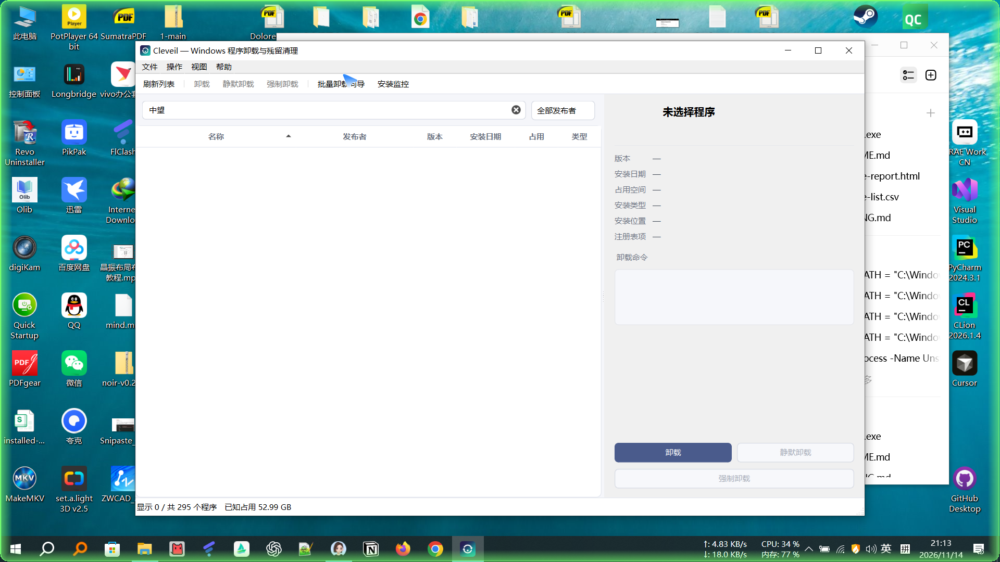
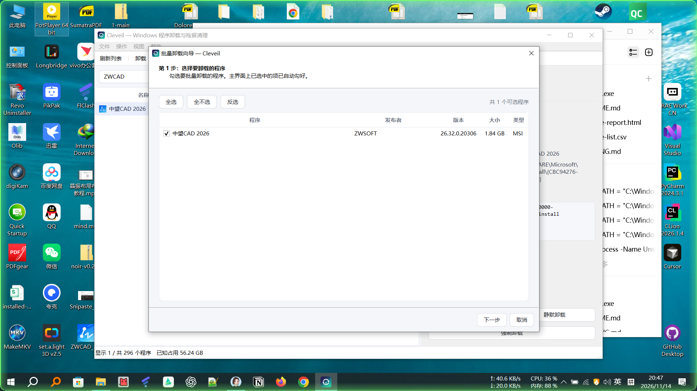
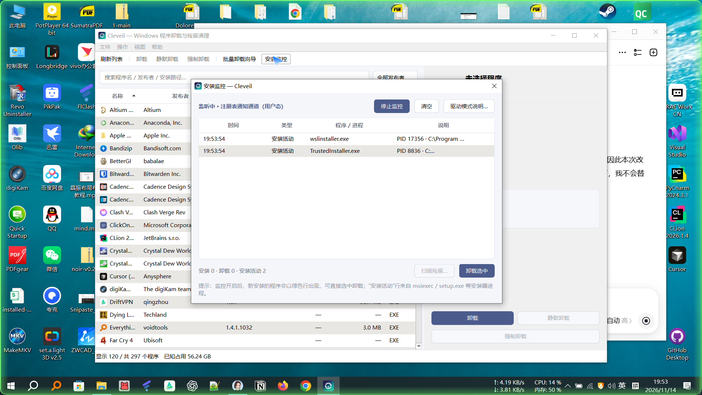
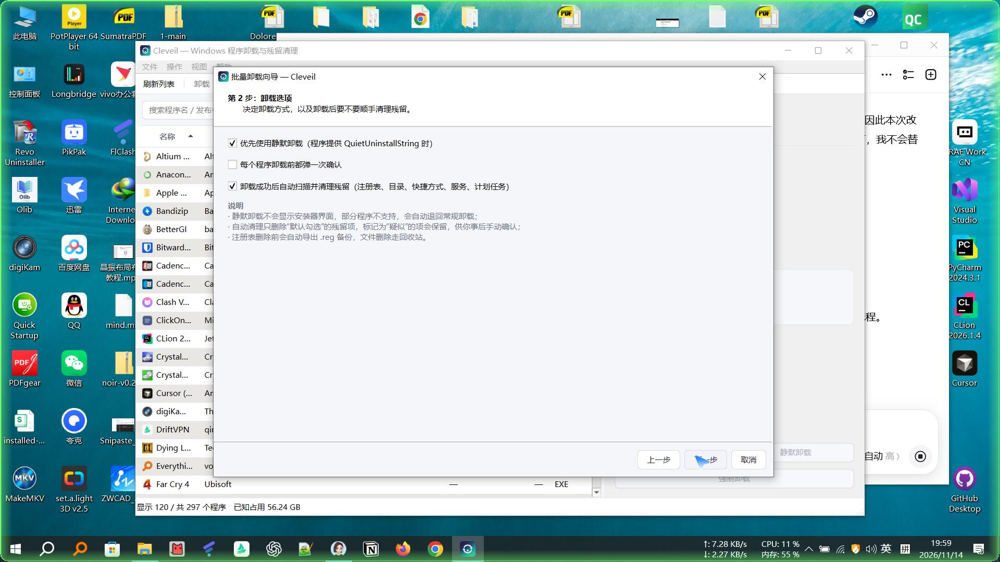
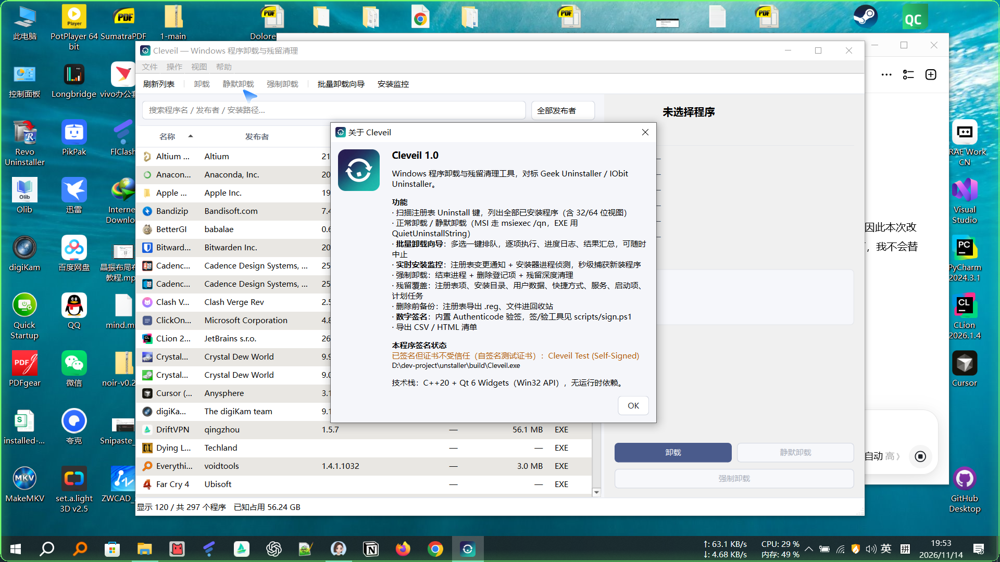

# Cleveil

**中文** ｜ [English](README.en.md)


Windows 程序卸载与残留清理工具：扫描已安装程序 → 列表浏览/搜索/排序 → 详情 → 正常卸载 / 静默卸载 /
批量卸载向导 → 强制卸载 + 残留深度清理 → 实时安装监控 → 导出清单。

不读任何第三方数据库，数据全部来自 Windows 自身的注册表与文件系统；卸载动作交还给程序自带的卸载器
（MSI 走 `msiexec`，EXE 走 `UninstallString`）。


## 目录

- [一、功能一览](#一功能一览)
- [二、界面](#二界面)
- [三、构建](#三构建)
- [四、目录结构](#四目录结构)
- [五、许可证与免责声明](#五许可证与免责声明)

---

## 一、功能一览

| 模块 | 能力 |
| --- | --- |
| **程序扫描** | 同时扫描 `HKLM` / `HKCU` 下的 `SOFTWARE\Microsoft\Windows\CurrentVersion\Uninstall` 与 `WOW6432Node` 对应分支（4 条路径），读取 DisplayName / DisplayVersion / Publisher / InstallDate / EstimatedSize / InstallLocation / DisplayIcon / UninstallString / QuietUninstallString / SystemComponent / ReleaseType / ParentKeyName / WindowsInstaller 等值；按 名称+版本+发布者 去重，机器级优先于用户级、64 位视图优先于 32 位视图 |
| **列表与筛选** | 6 列视图（名称 / 发布者 / 版本 / 安装日期 / 占用 / 类型），真实图标（三级来源：`DisplayIcon` → 卸载器自身图标 → 安装目录），点击表头排序（日期与体积按数值而非字符串排序），实时搜索（名称 / 发布者 / 路径），发布者过滤（全部 / 仅微软 / 仅第三方），可选显示系统组件与更新补丁，支持多选 |
| **详情面板** | 图标、名称、发布者、版本、安装日期、占用空间、安装类型（MSI / EXE）、安装位置、注册表项全路径、完整卸载命令（可选中复制）；长路径在分隔符后插入零宽空格折行，不会被面板裁掉 |
| **三种卸载方式** | ① **正常卸载**：调用注册表登记的卸载命令，可多选排队执行；② **静默卸载**：优先用 `QuietUninstallString`，MSI 追加 `/qn /norestart`，无静默参数的程序明确提示"不支持"而不是硬闯；③ **强制卸载**：结束相关进程 + 备份并删除注册表登记项 + 进入残留清理流程 |
| **批量卸载向导**（新增） | 三步向导：① 勾选程序（带全选/全不选/反选，主界面已选中的项自动带入）② 选策略（优先静默 / 逐项确认 / 卸载后自动清残留）③ 执行（进度条 + 逐条时间戳日志 + 成功失败跳过汇总，可随时停止，停止请求在当前一项结束后生效） |
| **实时安装监控**（新增） | 对四条 Uninstall 键挂 `RegNotifyChangeKeyValue`（内核写入时主动唤醒，无需轮询）+ 每 2 秒侦测 `msiexec` / `setup.exe` 等安装器进程；新装程序秒级出现并以绿色高亮，可当场卸载或扫描残留；卸载事件同样被捕获。检测到设备 `\\.\CleveilMon` 时自动切换为"内核驱动通道" |
| **数字签名**（新增） | 内置 Authenticode 验签：`WinVerifyTrust` 判完整性 + 证书链，`CryptQueryObject` 取签名者/签发者；配套 `scripts/sign.ps1` 支持自签名测试证书 / PFX / 证书指纹 + RFC3161 时间戳，详见 [docs/SIGNING.md](docs/SIGNING.md) |
| **残留清理** | 多线程扫描注册表（SOFTWARE 子树、App Paths、Run 启动项）、安装目录、`LOCALAPPDATA` / `APPDATA` / `PROGRAMDATA` / `Program Files` 下的同名目录、开始菜单与桌面快捷方式、Windows 服务、计划任务；按关键词强弱两级匹配，弱匹配默认**不勾选**；删除前把注册表项导出为 `.reg` 备份，目录走回收站；"预计释放"按最外层路径去重，父子目录不会重复计算 |
| **卸载队列** | 顺序执行、逐条日志（带时间戳）、进度条；**成功判定用"注册表项是否消失"核验，而不是相信退出码** |
| **导出** | CSV（UTF-8 BOM，Excel 直接双击不乱码）与 HTML 报告（带统计汇总与样式表格） |
| **设置** | 显示系统组件 / 显示更新补丁 / 启动自动扫描 / 静默卸载自动提权 / 删除前备份注册表，全部用 `QSettings` 持久化；窗口尺寸位置也记忆 |
| **品牌** | 应用名 **Cleveil**，圆角方形渐变图标（深靛蓝 → 青绿 + 白色循环箭头 + 被卸载的小方块），多尺寸 `app.ico`（16/24/32/40/48/64/128/256）嵌入 exe，同时通过 Qt 资源设置窗口图标 |

---

## 二、界面

| 主窗口 | 批量卸载向导（选择程序） | 安装监控 |
| --- | --- | --- |
|  |  |  |

| 批量卸载向导（卸载选项） | 关于窗口 |
| --- | --- |
|  |  |

---

## 三、构建

环境要求：

| 组件 | 版本（本项目实测） |
| --- | --- |
| Visual Studio | 2022 / 2026，需"使用 C++ 的桌面开发"工作负载（MSVC 19.5x） |
| Qt | 6.5 及以上，MSVC 套件（实测 6.11.1 `msvc2022_64`） |
| CMake | 3.21+（实测 3.30.5） |
| Ninja | 1.10+（实测 1.12.1） |

一键构建（脚本会自己调 `VsDevCmd.bat` 注入 MSVC 环境，不需要开"开发者命令提示符"）：

```powershell
cd Cleveil-1.0.0            # 进入项目目录（克隆/解压后的实际路径）
.\build.ps1                 # Release 构建 + windeployqt 部署 Qt 运行库
.\build.ps1 -Config Debug   # Debug 构建
.\build.ps1 -Clean          # 清空 build 后重来
```

手工构建：

```bat
call "C:\Program Files\Microsoft Visual Studio\18\Professional\Common7\Tools\VsDevCmd.bat" -arch=x64
"C:\Qt\Tools\CMake_64\bin\cmake.exe" -S . -B build -G Ninja -DCMAKE_BUILD_TYPE=Release -DCMAKE_PREFIX_PATH=C:/Qt/6.11.1/msvc2022_64
"C:\Qt\Tools\CMake_64\bin\cmake.exe" --build build
"C:\Qt\6.11.1\msvc2022_64\bin\windeployqt.exe" --release build\Cleveil.exe
```

产物：`build\Cleveil.exe`（连同同目录下的 Qt DLL 与 `platforms\`、`styles\` 等插件目录一起分发）。

## 四、目录结构

```
src/
├─ main.cpp                     入口：高 DPI 策略、Fusion 风格、QSS 主题、应用图标、OleInitialize
├─ core/
│  ├─ appinfo.h                 InstalledApp 数据结构 + PackageType 枚举
│  ├─ winutil.h/.cpp            Win32 封装：环境变量展开、图标转 QPixmap、提权执行、回收站删除、
│  │                            目录体积、注册表读写/备份/存在性、进程枚举与结束、服务枚举与删除
│  ├─ iconprovider.h/.cpp       三级图标来源 + 缓存 + 默认占位图绘制
│  ├─ registryscanner.h/.cpp    四路 Uninstall 键扫描、字段解析、去重合并
│  ├─ uninstaller.h/.cpp        卸载计划构建（MSI/EXE/静默）、命令行拆分、QProcess 与提权执行器
│  ├─ leftovers.h/.cpp          残留扫描（注册表/目录/快捷方式/服务/计划任务）+ 删除与备份
│  ├─ remover.h/.cpp            强制卸载：结束进程、备份并删除登记项、备份目录管理
│  ├─ exporter.h/.cpp           CSV / HTML 导出
│  ├─ installmonitor.h/.cpp     安装监控：注册表变更通知线程 + 安装器进程侦测 + 驱动通道 ABI
│  └─ signature.h/.cpp          Authenticode 验签（WinVerifyTrust + CryptQueryObject）
└─ ui/
   ├─ appmodel.h/.cpp           表格模型（懒加载图标、数值排序）+ 过滤代理模型
   ├─ mainwindow.h/.cpp         主窗口：菜单、工具栏、列表、详情、卸载入口、导出、提权重启、监控/批量入口
   ├─ uninstalldialog.h/.cpp    卸载队列对话框（顺序执行 + 日志 + 注册表核验）
   ├─ batchwizard.h/.cpp        批量卸载向导（QWizard 三页 + 顺序执行 + 自动清残留）
   ├─ monitordialog.h/.cpp      安装监控窗口（事件流 + 一键卸载 + 驱动模式说明）
   ├─ leftoverdialog.h/.cpp     残留清理对话框（QtConcurrent 后台扫描 + 进度回传 + 批量删除）
   └─ settingsdialog.h/.cpp     设置对话框
resources/
├─ icon-1024.png                图标原稿
├─ icon-256.png / app.ico       运行时 PNG / 多尺寸图标
├─ app.rc                       ICON + VERSIONINFO（产品名 Cleveil）
└─ resources.qrc                Qt 资源
scripts/
├─ make_icon.py                 图标加工脚本（圆角 + PNG + ICO）
└─ sign.ps1                     Authenticode 签名/验签脚本
docs/
└─ SIGNING.md                   签名方案、证书选择、驱动签名差异
```

---

## 五、许可证与免责声明

本项目以 **MIT License** 发布，见 [LICENSE](LICENSE)。

> **免责声明**：卸载与残留清理是不可逆操作，虽然删除前会备份
> 注册表项（`.reg`）并把文件移入回收站，仍请先在虚拟机或测试机上验证。作者不对因使用本工具造成的
> 数据丢失、系统损坏或业务中断负责。

若发现文档与实现不一致，以源码为准；欢迎提 Issue 指出。
